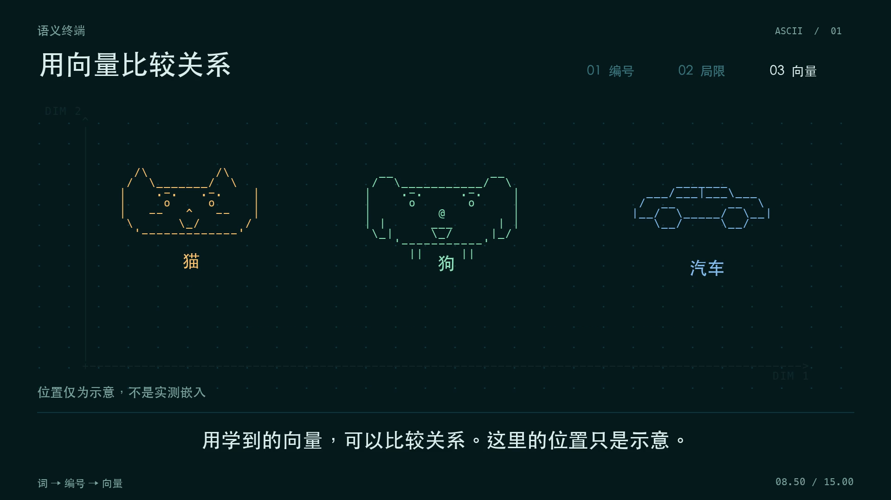
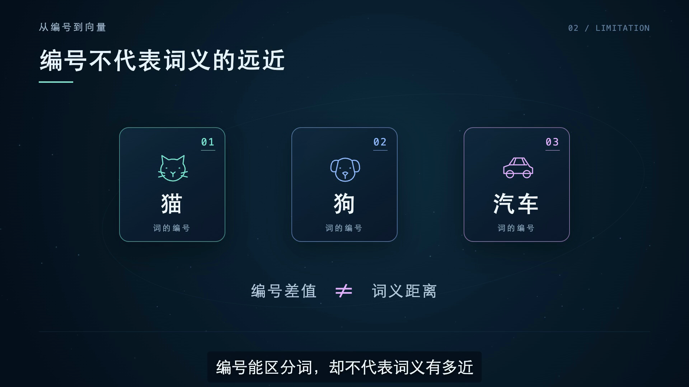

# 教师微课工作流

在本机运行的 Dify 微课制作流程。老师描述课程要求，确认讲稿和分镜，再生成配音、字幕和视频。也可以上传 PDF、PPTX，从课件中选择要讲的知识点。

```text
课程要求与材料 → 需求确认 → 教学安排 → 讲稿初稿 → 去 AI 味改写
→ 讲稿确认 → 制作分镜 → 分镜确认（可选）→ 配音与渲染 → 下载成片和工程
```

讲稿确认后，制作阶段保留原文。网络失败可从已保存的阶段继续。老师使用 Dify 发布页；需要调整节点时，打开「流程与测试」。

推荐用 **Gemini 生成讲稿，Claude 制作分镜和视频**。先生成完整讲稿，再单独按 `deslop-zh` 修改表达，交老师确认后进入制作。讲法由 Gemini 组织，镜头和动画由 Claude 根据定稿安排。

## 画面风格

| 暖色图解 | ASCII 终端科技 | 空间代码动画 |
|---|---|---|
|  |  |  |
| 纸面色彩、简洁图形、逐步标注 | 字符网格、程序界面、数据流 | 几何、镜头变化与空间层次 |

每种预设都有对应 Skill 和参考图，也支持自由设计、上传参考图片或视频。空间动画分支参考 OpenFilm 的制作方法；工作流统一用 HTML、Chromium 和 FFmpeg 导出。

## Skill 用途

| Skill | 用途与使用阶段 |
|---|---|
| [去 AI 味写作（deslop-zh）](skills/deslop-zh/SKILL.md) | 讲稿初稿完成后，单独修改表达，减少套话和翻译腔，保留知识、例子和推理。也用于需求沟通及界面文案。 |
| [视频制作主流程（explainer-video-production）](skills/explainer-video-production/SKILL.md) | 根据已确认讲稿安排分镜、声音、字幕和视频交付，并读取所选风格分支。 |
| [暖色图解](skills/explainer-video-production/branches/warm-explainer.md) | 用纸面色彩、文字和简洁图形逐步解释知识，适合平实的课堂讲解。 |
| [ASCII 终端科技](skills/explainer-video-production/branches/ascii-terminal.md) | 以字符网格构图，结合终端界面、节点和数据流，适合算法或程序过程的演示。 |
| [空间代码动画](skills/explainer-video-production/branches/openfilm-cinematic.md) | 参考 OpenFilm 的制作方法，用几何、空间层次和镜头变化展示关系，可按内容加入粒子与光效。 |

制作时组合主流程与选中的风格分支；去 AI 味写作在讲稿阶段使用。每个风格分支都配有上方对应的参考图。

## 安装与使用

当前提供源码安装，已验证环境为 macOS Apple Silicon。需要 Docker Desktop、Python 3.12+、Node.js 22+、FFmpeg，以及模型和阿里云百炼的 API 凭据。Codex 制作运行时随依赖安装。

1. 按[安装说明](docs/安装.md)准备本地工具和 Dify。
2. 导入工作流，点击 Dify 右上角「发布」，打开发布页。
3. 按[使用说明](docs/使用.md)提交课程要求，逐步确认并下载成片。

默认模型为 DeepSeek，配音为千问 `qwen-audio-3.0-tts-plus`、`longanlingxin`。模型分工可在配置中修改，详见[配置与扩展](docs/配置与扩展.md)。

## 仓库内容

| 目录 | 内容 |
|---|---|
| `workflow/` | 76 节点的 Dify 工作流 |
| `teacher_flow/` | 课件解析、模型调用、审核状态、制作、重试与导出 |
| `skills/` | 去 AI 味写作与三分支视频制作 Skill |
| `assets/style/` | 三种预设的参考图 |
| `dify-overlay/` | 相对 Dify 1.17.1 的界面与运行恢复改动 |
| `scripts/` | 本地安装、配置和启动入口 |

当前版本 `0.1.1`。完整功能、检查范围和待验证项见[验证说明](docs/验证.md)。

原创代码采用 MIT 许可；Dify 改动沿用 Dify 许可，写作 Skill 保留上游版权。来源及对应文件见[第三方说明](NOTICE.md)。
