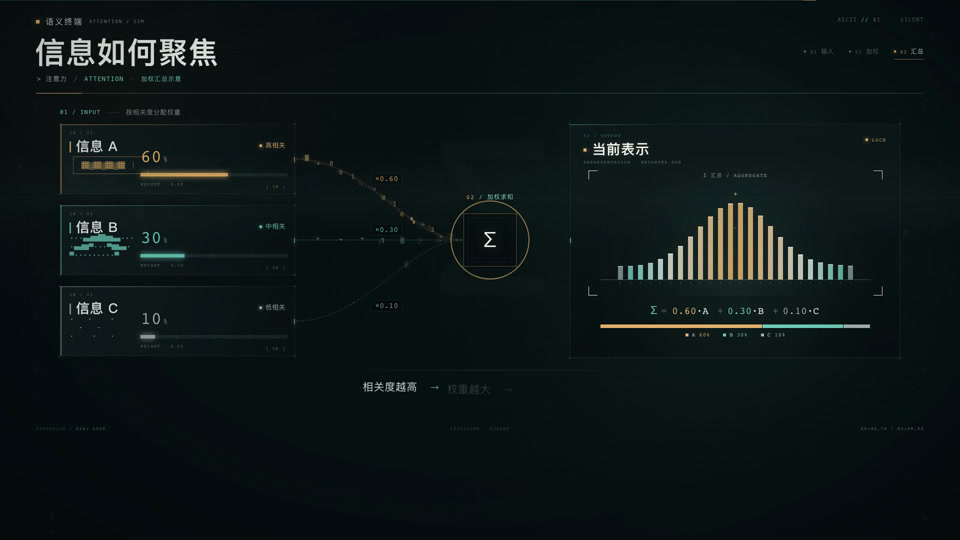
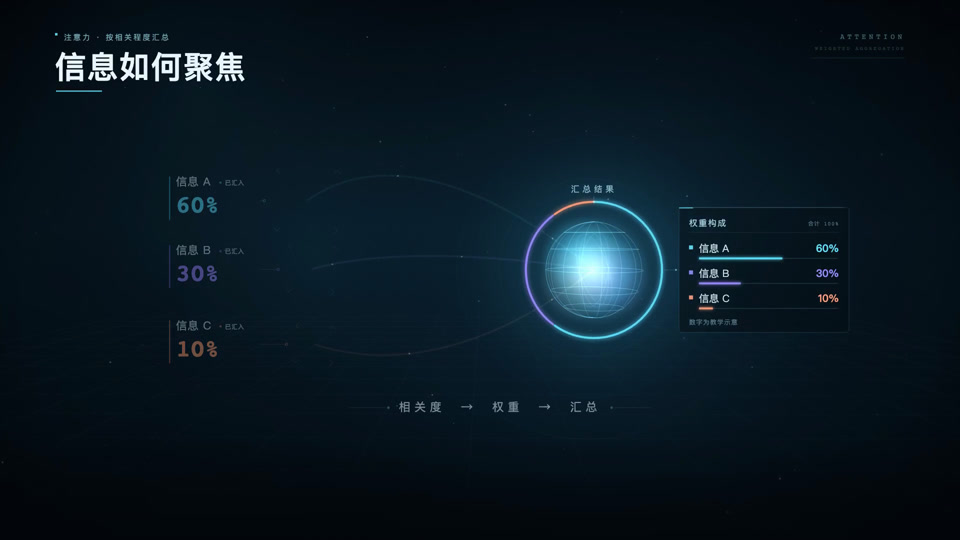
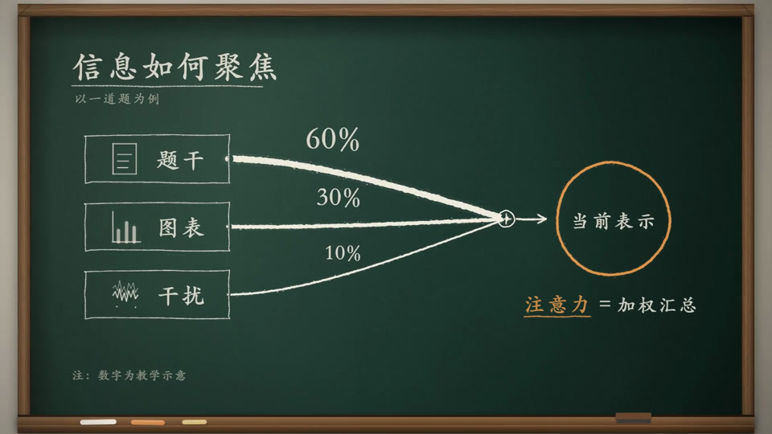
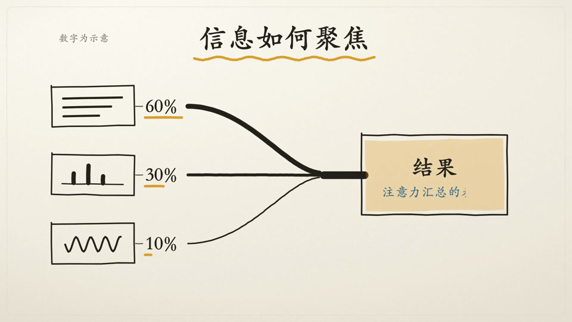
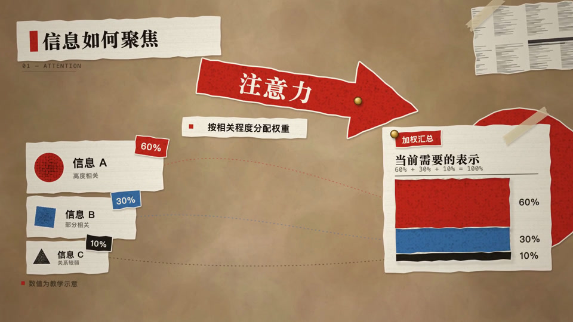
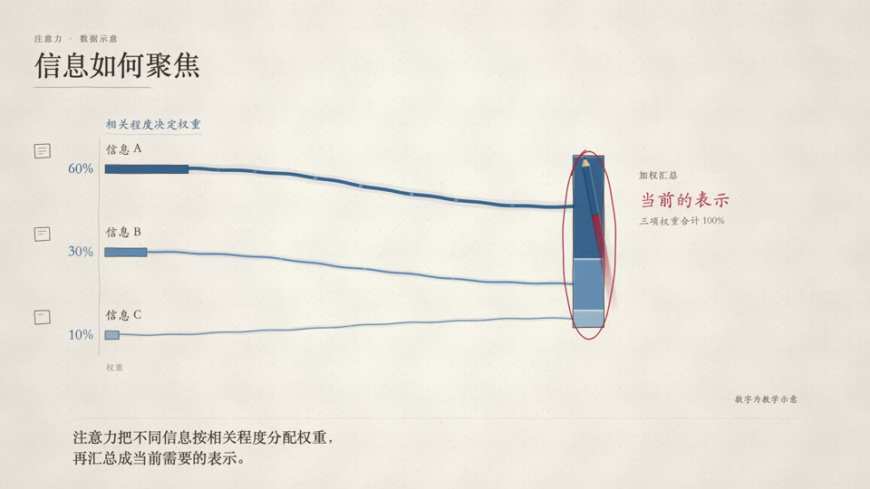
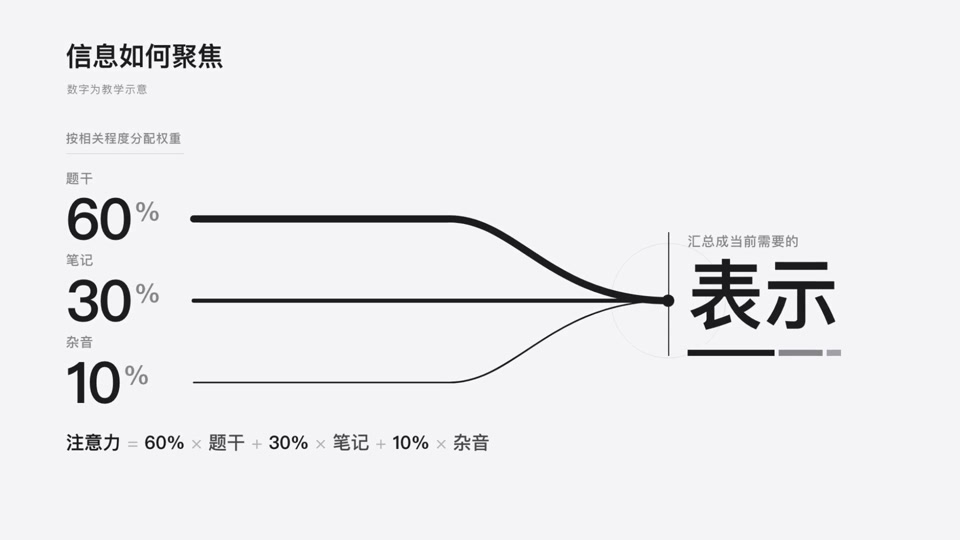

# 教师微课工作流

在本机运行的 Dify 微课制作流程。老师描述课程要求，或上传 PDF、PPTX 并选择知识点，确认讲稿和分镜后，生成配音、字幕、视频和可编辑工程。

```text
课程要求与材料 → 需求确认 → 教学安排 → 讲稿初稿 → 独立去 AI 味改写
→ 讲稿确认 → 制作分镜 → 分镜确认（可选）→ 配音与渲染 → 下载成片和工程
```

**v0.3.1 补齐十种风格的英文参考视频。** 开场选择课程语言，讲稿、配音、画面文字和字幕随之切换。两套模型方案共用 10 种风格、图片与视频参考、课件解析、审核弹窗、实时进度、暂停和断点重试。老师从 Dify 发布页制作课程，需要编辑节点时进入「流程与测试」。

[中文样片](https://phoiex.github.io/teacher-video-workflow/) · [English previews](https://phoiex.github.io/teacher-video-workflow/en.html) · [样片与源码](examples/style-previews/README.md)

## 选择模型方案

| 用途 | 质量优先 | 省钱方案（默认） |
|---|---|---|
| 课程规划、课件与参考素材理解 | GPT-6 Astra · `gpt-6-astra` | DeepSeek · `deepseek-flash` |
| 讲稿初稿 | Gemini 4 Argon · `gemini-4-argon` | Qwen3.8-Max · `qwen3.8-max` |
| 独立去 AI 味改写 | Gemini 4 Argon | Qwen3.8-Max |
| 分镜与视频制作 | Claude Opus 5.5 · `claude-opus-5-5` | DeepSeek · `deepseek-flash` |
| 制作执行框架 | Codex SDK＋本机协议适配 | DeepSeek Harness |
| 配音 | 阿里云千问 TTS | 阿里云千问 TTS |
| 配置文件 | [quality.json](presets/quality.json) | [economy.json](presets/economy.json) |
| Dify 流程 | [质量优先](workflow/teacher-video-quality.yml) | [省钱方案](workflow/teacher-video-economy.yml) |

推荐重视讲稿和画面效果的课程使用 **Gemini 写稿、Claude 制作视频**；日常试课和批量制作可先用 **DeepSeek＋Qwen**。这两套名称表示推荐取向，实际费用随文本量、制作轮数和服务商计费变化。

GPT、Claude 与 DeepSeek 示例设为 `max`；Qwen3.8-Max 开启思考，写稿和独立改写均设为最高档 `xhigh`；Gemini 使用服务默认值。Qwen 的三个档位是 `low`、`medium`、`xhigh`，兼容值 `max` 也映射到 `xhigh`，见[官方参数说明](https://help.aliyun.com/zh/model-studio/qwen-api-via-openai-chat-completions/)。模型名与参数都可修改。每课保存启动时的分工，旧课重试继续使用原配置。

## 需要开通哪些服务

| 方案 | API 服务 |
|---|---|
| 省钱方案 | [DeepSeek 开放平台](https://platform.deepseek.com/)＋[阿里云百炼](https://bailian.console.aliyun.com/)；百炼用于 Qwen 写稿和千问语音合成。 |
| 质量优先 | [OpenAI API](https://platform.openai.com/)、[Gemini API](https://aistudio.google.com/apikey)、[Claude API](https://platform.claude.com/)＋阿里云百炼配音。 |

在本地 `.env` 填写 API Key。百炼配音还需要北京地域的 Workspace ID。文字模型和语音服务分别确认开通与余额；桌面应用订阅不等同于这些 API 服务。具体字段和入口见[服务与音色配置](docs/服务与音色.md)。

默认配音：`qwen-audio-3.0-tts-plus`、女声 `longanlingxin`，24 kHz 单声道 WAV。同模型可选男声 `longanlufeng`；在 `.env` 修改 `TTS_VOICE` 后，新课程使用新音色，旧课程继续使用原设置。[官方音色与试听](https://help.aliyun.com/zh/model-studio/qwen-audio-tts-voice-list)

选择 `English` 后生成英文讲稿，并独立修改一轮表达，再交老师确认。配音使用英文参数，字幕按完整单词换行，导出视频和 SRT。[英文配音字幕短片](examples/english-course/README.md)

## 风格与 Skill

每个预设都有中文、英文两段 8 秒静音参考视频、对应 Skill 和参考图；新增七种还附作者指南或参考代码与来源。样片语言默认「随课程」，也可单独切换试看。点击视频播放，点击下方名称选择风格。模型读取所选风格的图片和说明，按需读取参考代码。也支持自由设计、自定义描述和上传图片、视频参考。

| 预设 | 样片（点击画面播放） | 用途与 Skill |
|---|---|---|
| 暖色图解 | [](assets/style/videos/warm.mp4) | 纸面色彩、文字与简洁图形。[分支](skills/explainer-video-production/branches/warm-explainer.md) |
| ASCII 终端科技 | [](assets/style/videos/ascii.mp4) | 字符网格、程序界面与数据流。[分支](skills/explainer-video-production/branches/ascii-terminal.md) |
| 空间代码动画 | [](assets/style/videos/openfilm.mp4) | OpenFilm 方法、几何与镜头变化。[分支](skills/explainer-video-production/branches/openfilm-cinematic.md) |
| 黑板粉笔 | [](assets/style/videos/chalkboard.mp4) | 按推导顺序书写、圈画和擦除。[分支](skills/explainer-video-production/branches/chalkboard.md) |
| 手绘白板 | [](assets/style/videos/whiteboard.mp4) | 手绘线条、箭头和局部标注。[分支](skills/explainer-video-production/branches/whiteboard.md) |
| 立体微缩工坊 | [](assets/style/videos/miniature-diorama.mp4) | 用微缩场景呈现结构和过程。[分支](skills/explainer-video-production/branches/miniature-diorama.md) |
| 纸张拼贴 | [](assets/style/videos/paper-collage.mp4) | 用剪纸、拼接与层次解释关系。[分支](skills/explainer-video-production/branches/paper-collage.md) |
| 水彩角色动画 | [](assets/style/videos/watercolor-character.mp4) | 水彩画面和角色叙事。[分支](skills/explainer-video-production/branches/watercolor-character.md) |
| 数据叙事 | [](assets/style/videos/data-storytelling.mp4) | 图表、数据变化与结论。[分支](skills/explainer-video-production/branches/data-storytelling.md) |
| 极简动态排版 | [](assets/style/videos/kinetic-typography.mp4) | 以文字节奏和版面变化突出概念。[分支](skills/explainer-video-production/branches/kinetic-typography.md) |

[视频制作主 Skill](skills/explainer-video-production/SKILL.md) 统筹分镜、声音和交付，再读取所选分支。[去 AI 味写作 Skill](skills/deslop-zh/SKILL.md) 在初稿完成后单独改写一轮，也用于需求沟通与界面文案。讲稿经老师确认后固定，制作阶段按原稿做画面。

## 安装与使用

需要 Docker Desktop、Git、Python 3.12+、Node.js 22+ 和 FFmpeg。Codex 与 DeepSeek Harness 随制作工具安装。当前安装和渲染主要在 macOS Apple Silicon 验证。

1. 按[安装说明](docs/安装.md)准备本地工具、API 配置与 Dify。
2. 导入省钱方案或质量优先方案，也可把两套同时导入同一个 Dify。
3. 点击「发布」→「运行应用」，按[使用说明](docs/使用.md)制作课程。

编辑模型和节点见[配置与扩展](docs/配置与扩展.md)。已有安装升级见[升级说明](docs/升级.md)。功能保留清单、检查结果与尚待实测的组合见[验证说明](docs/验证.md)。

## 仓库内容

`workflow/` 保存两套同结构的 76 节点流程，`presets/` 保存模型分工。`teacher_flow/` 包含课件读取、生成、审核、配音、渲染和重试；`skills/`、`assets/style/` 提供写作规则与风格材料。`dify-overlay/` 保留基于 Dify 1.17.1 的界面及恢复改动，`scripts/` 提供安装与启动命令。

原创代码采用 MIT 许可；Dify 改动沿用 Dify 许可，第三方 Skill 与参考代码保留原许可。见[来源与许可](NOTICE.md)。
