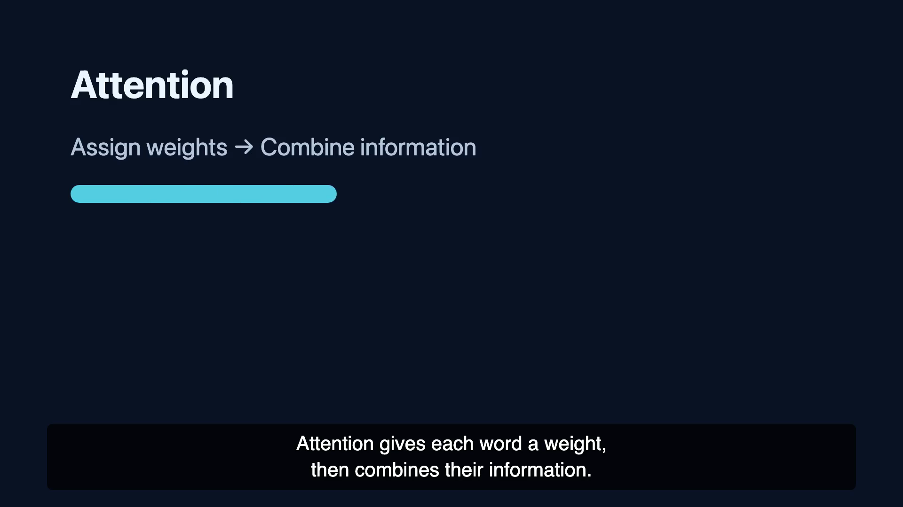

# 英文配音和字幕示例

[播放短片](https://phoiex.github.io/teacher-video-workflow/examples/english-course/preview.mp4) · [下载字幕](preview.srt) · [场景源码](scene.html) · [讲稿](script.txt)

2026-11-04，用一条固定英文稿验证配音与字幕，成片约 5.38 秒，1080p30，H.264＋AAC。阿里云 `qwen-audio-3.0-tts-plus`／`longanlingxin` 合成英文语音，字幕按真实音频起止时间显示，按完整单词断行。

这段用于检查英文输出，讲稿和画面是固定测试输入；未调用写稿模型。完整英文课程由老师从发布页选择 English 后启动。
